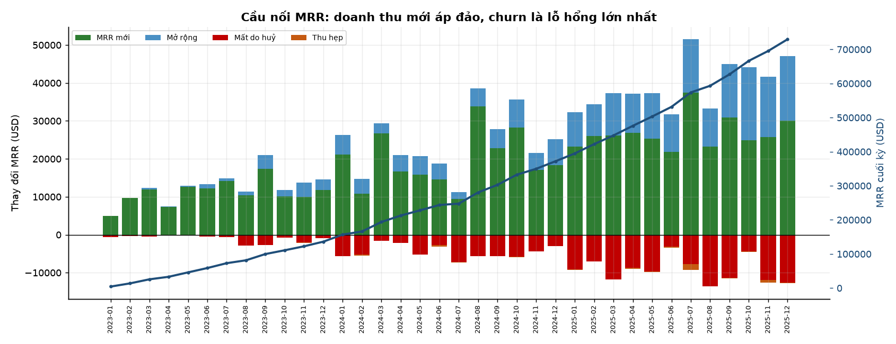
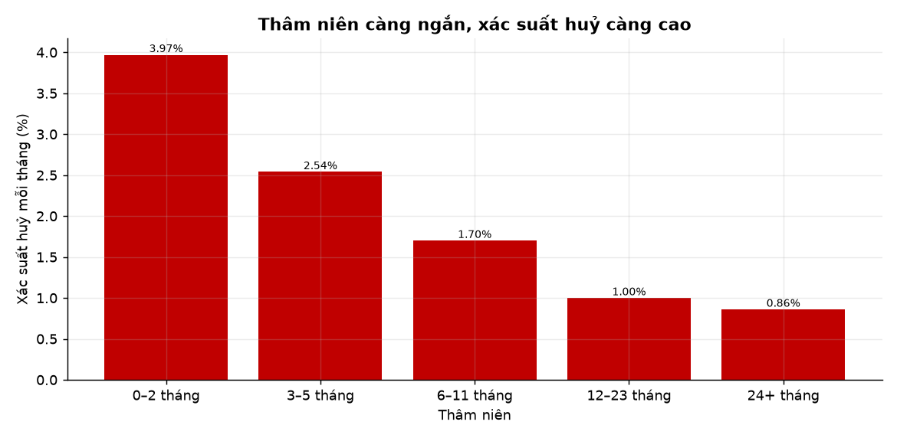
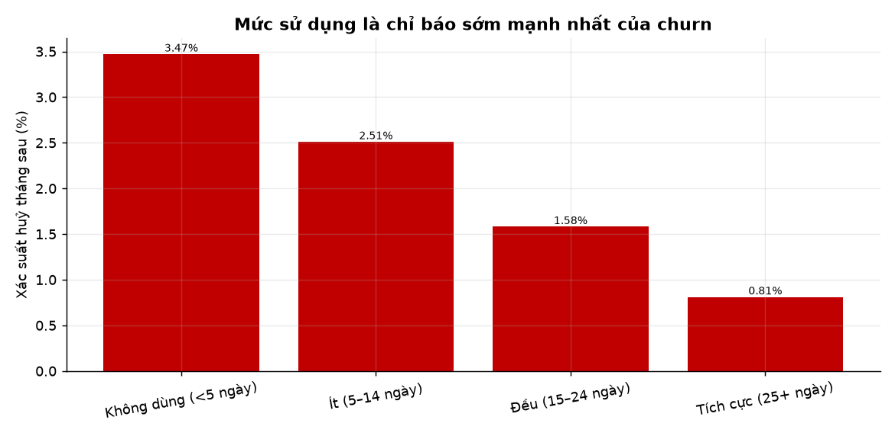
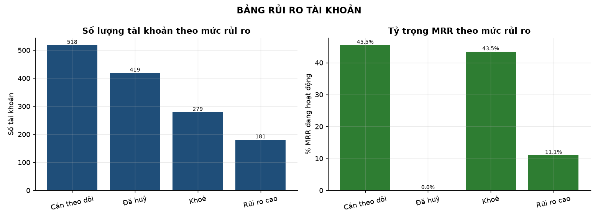

# SaaS Revenue Analytics

Phân tích doanh thu định kỳ và giữ chân khách hàng của một công ty SaaS B2B — trả lời câu hỏi mà mọi bảng điều khiển tài chính đều né tránh: **doanh thu tăng vì có thêm khách mới, hay vì khách cũ chi nhiều hơn?**

> Dự án danh mục #3 · Python + SQLite + SQL thuần · Không ML, không dashboard

---

## Ba con số đáng chú ý

| Chỉ số | Giá trị | Ý nghĩa |
|---|---|---|
| **NRR 12 tháng** | **103,7%** | Tập khách cũ tự sinh thêm 3,7% doanh thu |
| **GRR 12 tháng** | **76,0%** | Nhưng nếu không tính mở rộng, mất gần 1/4 doanh thu |
| **MRR cuối kỳ** | **$729.625** | Từ $0 sau 36 tháng, nhưng 63% tăng trưởng đến từ khách mới |

**Kết luận cốt lõi:** doanh thu tăng trưởng đẹp trên biểu đồ, nhưng động cơ thật là **mua khách mới**, không phải giữ khách cũ. Mỗi năm mất 24% doanh thu nền; phần mở rộng chỉ vừa đủ bù.



---

## Phát hiện chính

### 1. NRR che giấu một lỗ hổng lớn

NRR 103,7% trông ổn. Nhưng GRR chỉ 76% nghĩa là **mỗi năm mất gần một phần tư doanh thu nền** do huỷ và hạ gói. Toàn bộ phần chênh lệch đến từ mở rộng — và mở rộng tập trung ở nhóm Enterprise.

| Gói | NRR đóng góp | Churn | MRR ròng từ mở rộng |
|---|---|---|---|
| Enterprise | +177.969 | 11,6% | **+$128.297** |
| Business | +35.387 | 23,3% | −$27.795 |
| Growth | +8.292 | 38,2% | −$45.686 |
| Starter | +360 | 43,2% | −$14.912 |

Chỉ Enterprise tự nuôi được mình. Ba gói còn lại đang **rút ròng** khỏi doanh thu.

### 2. Ba tháng đầu quyết định tất cả



Xác suất huỷ giảm đơn điệu theo thâm niên: **3,97%/tháng** ở tháng 0–2, xuống **0,86%** sau 2 năm — chênh **4,6 lần**.

Nói cách khác: khách sống qua 3 tháng đầu gần như ở lại. Mọi nỗ lực giữ chân nên dồn vào onboarding, không phải vào khách lâu năm.

### 3. Mức sử dụng là chỉ báo sớm mạnh nhất



| Mức sử dụng | Xác suất huỷ tháng sau |
|---|---|
| Không dùng (< 5 ngày) | 3,47% |
| Ít (5–14 ngày) | 2,51% |
| Đều (15–24 ngày) | 1,58% |
| Tích cực (25+ ngày) | **0,81%** |

Chênh **4,3 lần** giữa nhóm không dùng và nhóm tích cực. Đây là tín hiệu có thể hành động ngay, có trước khi khách gọi điện huỷ.

### 4. Thanh toán thất bại là kênh mất khách đắt nhất

18,4% số vụ huỷ là **ngoài ý muốn** (thẻ hỏng, không phải khách chủ động bỏ). Nhưng nhóm này chiếm **$61.616 MRR** — cao hơn bất kỳ lý do chủ động nào.

| Lý do huỷ | Số vụ | MRR mất | MRR trung bình/vụ |
|---|---|---|---|
| Không còn nhu cầu | 81 | $27.454 | $339 |
| Quá đắt | 78 | $23.454 | $301 |
| **Thanh toán thất bại** | **77** | **$61.616** | **$800** |
| Thiếu tính năng | 74 | $22.531 | $304 |

Tỷ lệ thu hồi sau khi thử lại là **78%** — nghĩa là cứ 5 thẻ hỏng thì 1 khách ra đi vĩnh viễn, dù họ không hề muốn.

### 5. Kênh thu hút quyết định chất lượng khách

| Kênh | Churn | Thâm niên trung bình khi huỷ |
|---|---|---|
| Paid search | 35,6% | 5,7 tháng |
| Outbound | 35,3% | 5,9 tháng |
| Partner | 29,5% | 7,1 tháng |
| Organic | 25,7% | 7,5 tháng |
| Referral | **22,9%** | 4,8 tháng |

Khách từ **referral** giữ chân tốt nhất, khách từ **quảng cáo trả tiền** rời bỏ nhiều nhất. Chi phí thu hút cao hơn nhưng vòng đời ngắn hơn — bài toán CAC/LTV đảo chiều.

### 6. Chỉ 1/5 tài khoản đang khoẻ



| Trạng thái | Số tài khoản | % MRR đang hoạt động |
|---|---|---|
| Khoẻ | 279 (20,0%) | 43,5% |
| Cần theo dõi | 518 (37,1%) | 45,5% |
| Rủi ro cao | 181 (13,0%) | **11,1%** |
| Đã huỷ | 419 (30,0%) | — |

Nhóm rủi ro cao tuy chỉ chiếm 13% tài khoản nhưng giữ **$80.602 MRR**. Đây là danh sách gọi điện của đội CS.

---

## Điểm đáng chú ý về phương pháp

**Không dùng "số ticket" để dự báo churn.** Cách làm trực quan — đếm ticket mỗi tài khoản rồi so tỷ lệ huỷ — cho ra kết quả **ngược hoàn toàn**: nhóm 0 ticket có tỷ lệ huỷ 52%, nhóm 6+ ticket chỉ 13%.

Sai ở đâu? Tài khoản rời sớm có ít thời gian mở ticket. Đó là **thiên lệch sống sót** (survival bias), không phải quan hệ nhân quả.

Cách đúng: tính trên **từng ticket**, đo xem tài khoản có huỷ trong 3 tháng sau đó không. Kết quả: thời gian xử lý ticket **không** dự báo churn (7,30% vs 7,32% — không khác biệt), nhưng **điểm hài lòng thì có**:

| Điểm hài lòng | Churn trong 3 tháng sau |
|---|---|
| 1–2 điểm | **8,32%** |
| 3 điểm | 7,11% |
| 4 điểm | 6,50% |
| 5 điểm | 7,08% |

---

## Chạy dự án

```bash
pip install -r requirements.txt
python run_all.py
```

Pipeline gồm 5 bước, chạy từ đầu đến cuối trong khoảng 15 giây:

| Bước | Nội dung |
|---|---|
| 1 | Sinh bộ dữ liệu mô phỏng (6 CSV, seed cố định) |
| 2 | Nạp tầng staging vào SQLite |
| 3 | Transform sang star schema (dim + fact) |
| 4 | Chạy 9 mô-đun SQL, xuất 23 CSV + 20 chart |
| 5 | Kiểm tra chất lượng: **45/45 quy tắc PASS** |

Kết quả:
- `reports/*.csv` — 23 bảng kết quả
- `reports/figures/*.png` — 20 biểu đồ
- `docs/findings.md` — báo cáo phân tích đầy đủ

---

## Cấu trúc

```
saas-revenue-analytics/
├── run_all.py                 # chạy toàn bộ pipeline
├── src/
│   ├── etl/
│   │   ├── config.py          # đường dẫn + hằng số
│   │   ├── generate_data.py   # sinh dữ liệu mô phỏng
│   │   ├── build_db.py        # nạp staging
│   │   ├── transform.py       # star schema
│   │   └── validate.py        # 45 quy tắc chất lượng
│   └── analysis/
│       └── run_marts.py       # chạy SQL + CSV + chart
├── sql/
│   ├── schema.sql
│   └── 03_analysis/           # 9 mô-đun phân tích
├── docs/
│   ├── idea.md                # ý tưởng và câu hỏi nghiên cứu
│   ├── data_dictionary.md     # từ điển dữ liệu
│   ├── getting_data.md        # cơ chế sinh dữ liệu
│   └── findings.md            # báo cáo đầy đủ
├── notebooks/01_explore.ipynb # EDA
├── data/                      # không commit (sinh lại bằng script)
└── reports/                   # CSV + chart
```

---

## Về dữ liệu

**Đây là dữ liệu mô phỏng, không phải dữ liệu thật.**

Không có bộ dữ liệu SaaS công khai nào chứa đủ chuỗi sự kiện gốc (đăng ký → nâng cấp → cắt ghế → huỷ) để tính MRR và NRR từ đầu. Các bộ trên Kaggle hoặc quá nhỏ, hoặc đã tổng hợp sẵn nên không thể tái tạo phép tính.

`generate_data.py` sinh ra chuỗi sự kiện **ở dạng thô**, giống hệt export từ một hệ thống billing thật, với các tham số được hiệu chỉnh để khớp hành vi SaaS B2B điển hình:

| Tham số | Giá trị | Chuẩn ngành |
|---|---|---|
| Churn logo/tháng | ~2,4% | 2–3% |
| NRR/năm | 103% | 100–110% |
| GRR/năm | 79% | 75–85% |
| Tỷ lệ thu hồi dunning | 78% | 70–80% |

Toàn bộ phép tính MRR/NRR/cohort phía sau **là SQL thật**, nên pipeline dùng được nguyên vẹn với dữ liệu thật — chỉ cần thay bước 1 bằng bước nạp export từ hệ thống billing.

Chi tiết cơ chế sinh: [docs/getting_data.md](docs/getting_data.md)

---

## Quyết định thiết kế

| # | Quyết định | Lý do |
|---|---|---|
| D1 | MRR tính từ **chuỗi sự kiện**, không lưu sẵn theo tháng | Một nguồn sự thật duy nhất; mọi chỉ số đều suy ra được |
| D2 | `dim_month.year_month_no` | Tính thâm niên và độ trễ mà không cần xử lý ngày |
| D3 | Churn ghi nhận ở **tháng cuối còn hoạt động** | Khách vẫn dùng và vẫn trả tiền trong tháng đó |
| D4 | Tách `fact_invoices` khỏi `fact_subscription_events` | Hoá đơn thất bại không làm sai lệch MRR hợp đồng |
| D5 | Phân tích support trên **từng ticket**, không theo tài khoản | Loại bỏ thiên lệch sống sót |
| D6 | Cohort chỉ kết luận khi đủ 12 tháng (`is_mature`) | Cohort mới chưa đủ dữ liệu, dễ kết luận sai |

---

## Công nghệ

Python 3.10+ · pandas · numpy · matplotlib · SQLite

Toàn bộ tầng phân tích là **SQL thuần**, không dùng ORM, không dùng dataframe để tính chỉ số nghiệp vụ.

---

## Giấy phép

MIT — xem [LICENSE](LICENSE)
