# Báo cáo phân tích — SaaS Revenue Analytics

**Kỳ phân tích:** 01/2023 – 12/2025 (36 tháng)
**Quy mô:** 1.397 tài khoản · 15.897 hoá đơn · 8.476 ticket hỗ trợ
**Doanh thu luỹ kế ghi nhận:** $10.727.423
**MRR cuối kỳ:** $729.625 (ARR $8,76 triệu)

---

## Tóm tắt điều hành

Công ty tăng MRR từ 0 lên $729.625 trong 36 tháng — đường cong đẹp trên mọi báo cáo. Nhưng khi tách phần tăng trưởng ra thành từng thành phần, bức tranh khác hẳn:

| Thành phần | MRR | % tổng biến động |
|---|---:|---:|
| Khách mới | +689.721 | 63,1% |
| Mở rộng (thêm ghế, nâng gói) | +222.008 | 20,3% |
| Thu hẹp | −4.923 | 0,5% |
| **Mất do huỷ** | **−177.181** | **16,2%** |

**Tăng trưởng đang được mua bằng ngân sách marketing, không phải được tạo ra bởi tệp khách hiện hữu.**

Ba chỉ số đo cùng một hiện tượng ở ba góc:

| Chỉ số | Giá trị | Diễn giải |
|---|---:|---|
| NRR 12 tháng | **103,7%** | Tệp khách cũ tự sinh thêm 3,7% doanh thu → nghe có vẻ ổn |
| GRR 12 tháng | **76,0%** | Không tính mở rộng, mất 24% doanh thu nền mỗi năm |
| Churn logo/tháng | **~2,4%** | Vòng đời trung bình ~42 tháng |

Khoảng cách 27 điểm giữa NRR và GRR chính là toàn bộ giá trị của hoạt động mở rộng. Nếu bộ phận upsell dừng lại một quý, doanh thu sẽ **co lại** ngay.

---

## 1. Cầu nối MRR — động cơ thật của tăng trưởng

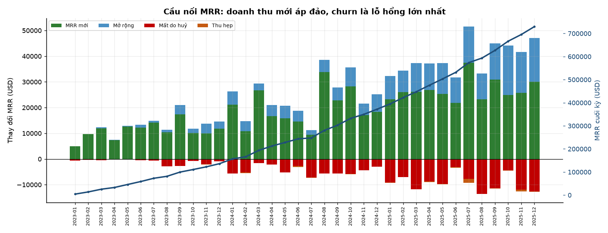

Mỗi tháng có hai dòng chảy ngược chiều:

- **Vào:** khách mới trung bình $19.159/tháng, mở rộng $6.167/tháng
- **Ra:** huỷ $4.922/tháng, thu hẹp $137/tháng

Tỷ lệ vào/ra khoảng 5:1 — nên tăng trưởng luôn dương, nhưng **phải liên tục đổ thêm khách mới vào mới giữ được đà**. Đây là mô hình "xô nước thủng đáy": mức nước dâng vì vòi chảy mạnh, không phải vì xô kín.

Nếu dừng thu hút khách mới ngay hôm nay, MRR sẽ giảm 1,98%/tháng (GRR 98,02%) → mất khoảng 21% sau một năm.

**Chỉ số theo dõi:** tỷ trọng MRR tăng đến từ khách cũ (`expansion / (new + expansion)`). Hiện tại là 24,4%. Mục tiêu lành mạnh cho SaaS trưởng thành: trên 50%.

---

## 2. Cohort retention — ba tháng đầu quyết định tất cả

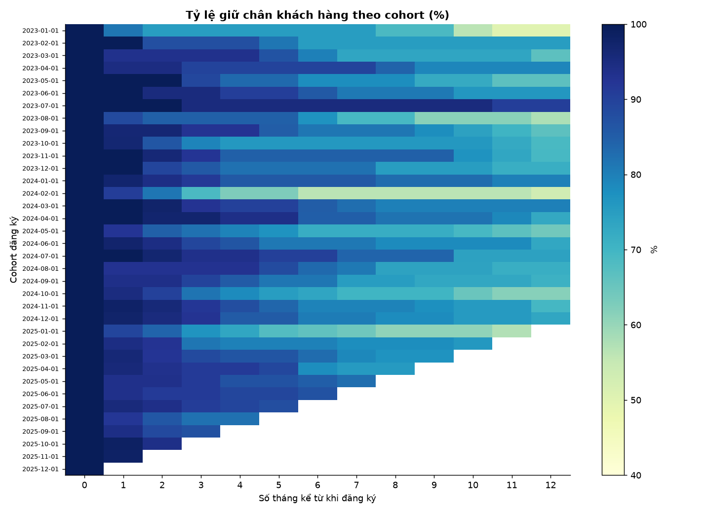

Đọc bảng heatmap theo hàng: mỗi hàng là một lứa khách đăng ký cùng tháng, đi ngang là số tháng sống sót.

| Cohort | Ban đầu | Sau 3 tháng | Sau 6 tháng | Sau 12 tháng |
|---|---:|---:|---:|---:|
| 2023-01 | 16 | 75,0% | 75,0% | 50,0% |
| 2023-03 | 15 | 93,3% | 80,0% | 66,7% |
| 2023-06 | 21 | 95,2% | 85,7% | 76,2% |
| 2023-07 | 21 | 95,2% | 95,2% | **90,5%** |
| 2023-10 | 29 | 79,3% | 75,9% | 69,0% |
| 2023-12 | 28 | 85,7% | 82,1% | 71,4% |

Hai quan sát:

1. **Đường cong dốc nhất ở 3 tháng đầu**, sau đó gần như phẳng. Khách sống qua tháng thứ 3 có xác suất ở lại rất cao.
2. **Dao động lớn giữa các cohort** (12 tháng: 50% → 90%) vì cỡ mẫu nhỏ (15–29 tài khoản/lứa). Với cohort dưới 20 tài khoản, chênh lệch 1–2 khách làm thay đổi 5–10 điểm phần trăm — **không nên kết luận về xu hướng giữa các cohort**.

---

## 3. NRR và GRR — con số đẹp che lỗ hổng

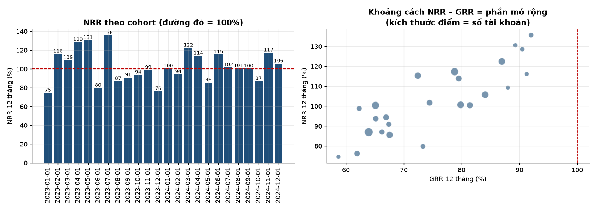

| Chỉ số | Theo tháng | Quy đổi năm |
|---|---:|---:|
| NRR trung bình | 100,24% | **102,94%** |
| GRR trung bình | 98,02% | **78,69%** |
| NRR cohort 12 tháng (gộp) | — | 103,67% |
| GRR cohort 12 tháng (gộp) | — | 76,01% |

**Phần mở rộng đóng góp 27,7 điểm** (103,67 − 76,01). Toàn bộ phần này đến từ một nhóm nhỏ khách hàng — xem mục 5.

Biểu đồ bên phải cho thấy mối quan hệ NRR–GRR theo từng cohort. Các cohort nằm xa đường chéo 45° là những lứa có hoạt động upsell mạnh; các cohort nằm sát đường chéo gần như không mở rộng được gì.

---

## 4. Ai rời bỏ, và rời ở tháng thứ mấy?

### 4.1 Theo thâm niên — vực thẳm onboarding

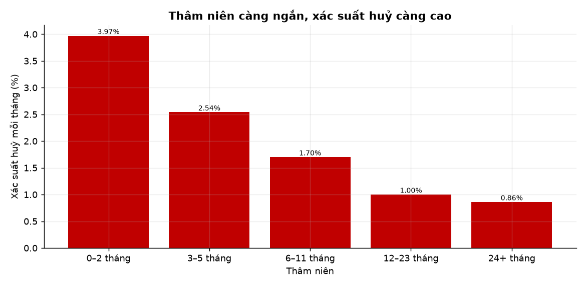

| Thâm niên | Xác suất huỷ/tháng | So với nhóm 24+ tháng |
|---|---:|---:|
| 0–2 tháng | **3,97%** | ×4,6 |
| 3–5 tháng | 2,54% | ×3,0 |
| 6–11 tháng | 1,70% | ×2,0 |
| 12–23 tháng | 1,00% | ×1,2 |
| 24+ tháng | 0,86% | — |

Quan hệ **đơn điệu và rất mạnh**. Đây là phát hiện có tính hành động cao nhất của toàn bộ phân tích: can thiệp vào tháng 0–2 có đòn bẩy gấp 4,6 lần so với chăm sóc khách lâu năm.

### 4.2 Theo gói

| Gói | Tài khoản | Đã huỷ | Tỷ lệ huỷ |
|---|---:|---:|---:|
| Starter | 248 | 109 | **43,95%** |
| Growth | 533 | 187 | 35,08% |
| Business | 474 | 103 | 21,73% |
| Enterprise | 142 | 20 | **14,08%** |

### 4.3 Theo kênh thu hút

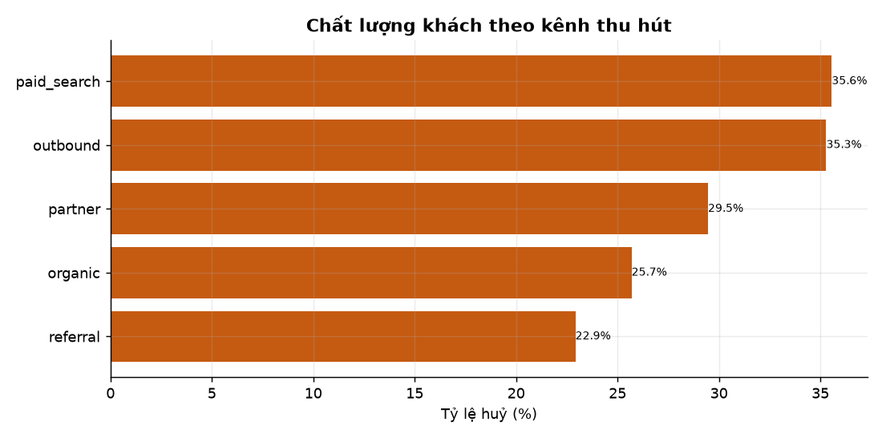

| Kênh | Tài khoản | Tỷ lệ huỷ | Thâm niên TB khi huỷ |
|---|---:|---:|---:|
| Paid search | 255 | **35,29%** | 5,9 tháng |
| Outbound | 255 | 35,29% | 5,9 tháng |
| Partner | 224 | 29,46% | 7,1 tháng |
| Organic | 397 | 25,69% | 7,5 tháng |
| Referral | 192 | **22,92%** | 4,8 tháng |

**Referral giữ khách tốt nhất** (22,9%), **quảng cáo trả tiền tệ nhất** (35,3%) — chênh 12,4 điểm. Nếu CAC của paid search cao hơn referral (thường gấp 2–3 lần) trong khi vòng đời lại ngắn hơn, kênh này đang phá huỷ giá trị.

### 4.4 Theo quy mô công ty

| Quy mô | Tài khoản | Tỷ lệ huỷ | MRR khởi điểm TB |
|---|---:|---:|---:|
| SMB (<100 nhân viên) | 881 | 33,94% | $213 |
| Mid-market (100–999) | 504 | 23,61% | $842 |
| Enterprise (1000+) | 12 | 8,33% | $4.333 |

> ⚠️ Nhóm Enterprise chỉ có **12 tài khoản** — tỷ lệ 8,33% thực chất là 1/12. Không đủ mẫu để kết luận; chỉ nên đọc chiều hướng.

### 4.5 Lý do huỷ

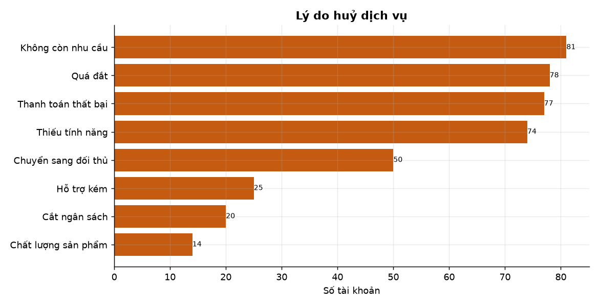

| Lý do | Số vụ | % | MRR mất | MRR TB/vụ |
|---|---:|---:|---:|---:|
| Không còn nhu cầu | 81 | 19,3% | $27.454 | $339 |
| Quá đắt | 78 | 18,6% | $23.454 | $301 |
| **Thanh toán thất bại** | 77 | 18,4% | **$61.616** | **$800** |
| Thiếu tính năng | 74 | 17,7% | $22.531 | $304 |
| Chuyển sang đối thủ | 50 | 11,9% | $17.162 | $343 |
| Hỗ trợ kém | 25 | 6,0% | $12.032 | $481 |
| Cắt ngân sách | 20 | 4,8% | $8.758 | $438 |
| Chất lượng sản phẩm | 14 | 3,3% | $4.174 | $298 |

Điểm đáng chú ý: **thanh toán thất bại chỉ chiếm 18,4% số vụ nhưng 34,8% tổng MRR mất đi**, vì tài khoản bị huỷ kiểu này lớn gấp 2,4 lần mức trung bình. Đây là nhóm "khách tốt bị mất oan".

---

## 5. Cơ cấu gói — chỉ Enterprise tự nuôi được mình

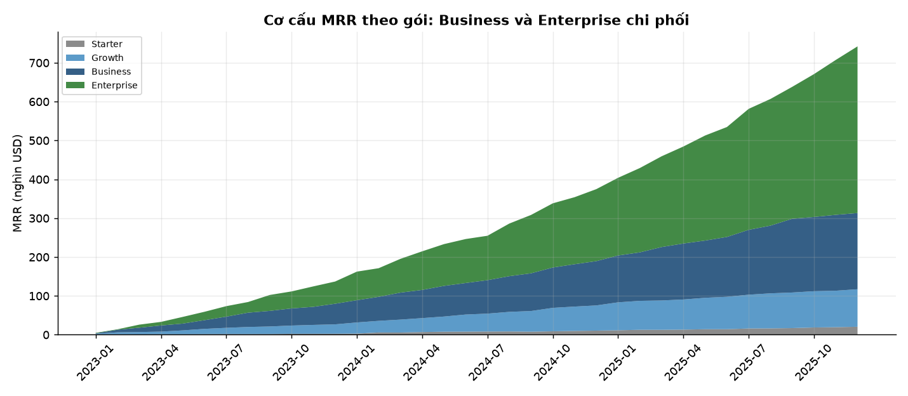

| Gói | MRR hiện tại | Tài khoản hoạt động | MRR/tài khoản | Tỷ lệ huỷ | Mở rộng | Thu hẹp | Mất do huỷ | **Ròng** |
|---|---:|---:|---:|---:|---:|---:|---:|---:|
| Enterprise | $422.280 | 221 | $1.911 | 11,60% | +$177.969 | −$308 | −$49.364 | **+$128.297** |
| Business | $194.490 | 312 | $623 | 23,34% | +$35.387 | −$2.759 | −$60.423 | −$27.795 |
| Growth | $93.477 | 303 | $309 | 38,16% | +$8.292 | −$1.200 | −$52.778 | −$45.686 |
| Starter | $19.378 | 142 | $136 | 43,20% | +$360 | −$656 | −$14.616 | −$14.912 |

**Một mình Enterprise tạo ra toàn bộ giá trị ròng.** Ba gói còn lại đều âm — nghĩa là về mặt doanh thu thuần, công ty đang **trả tiền để giữ chân** nhóm khách nhỏ.

Câu hỏi chiến lược đặt ra: nếu gói Starter chỉ đóng góp $19.378 MRR (2,7%) nhưng tiêu tốn nguồn lực hỗ trợ và có tỷ lệ huỷ 44%, có nên **bỏ hoặc tự động hoá hoàn toàn** gói này?

---

## 6. Mức sử dụng — chỉ báo sớm mạnh nhất

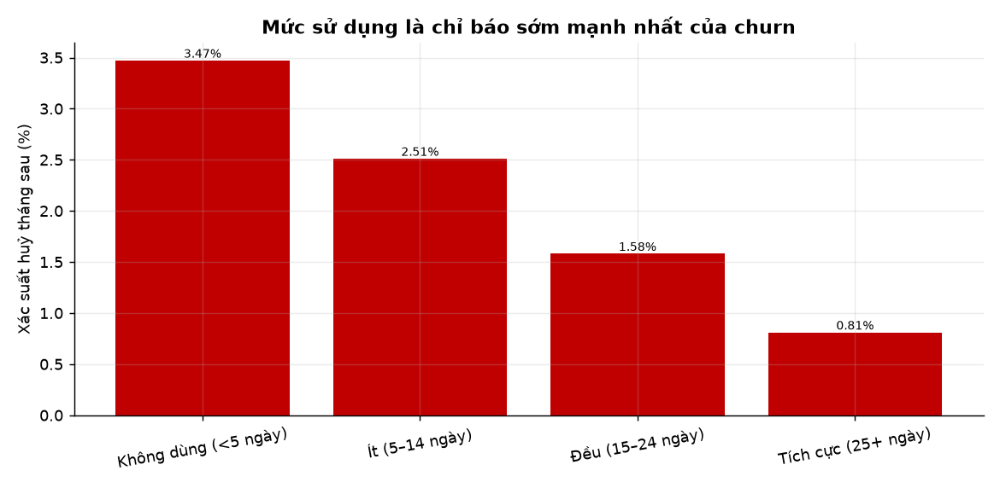

| Mức sử dụng (ngày hoạt động/tháng) | Số quan sát | Huỷ tháng sau | Tỷ lệ |
|---|---:|---:|---:|
| Không dùng (< 5 ngày) | 1.583 | 55 | **3,47%** |
| Ít (5–14 ngày) | 8.359 | 210 | 2,51% |
| Đều (15–24 ngày) | 5.585 | 88 | 1,58% |
| Tích cực (25+ ngày) | 370 | 3 | **0,81%** |

Chênh **4,3 lần** giữa hai cực. Vì dữ liệu sử dụng có sẵn hàng tháng, đây là tín hiệu **có trước** khi khách gọi điện huỷ — khác với việc ngồi chờ ticket phàn nàn.

### 6.1 Bảng rủi ro tài khoản

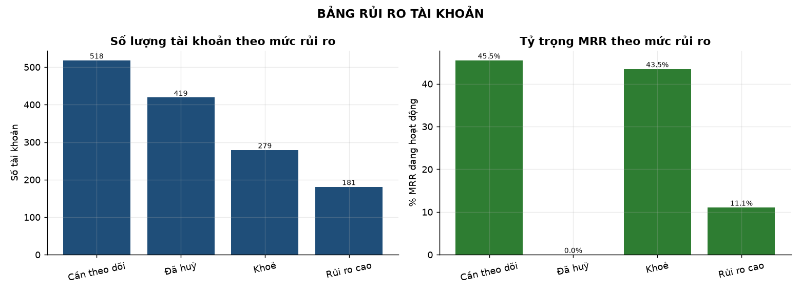

| Trạng thái | Tài khoản | % | MRR đang hoạt động | % MRR |
|---|---:|---:|---:|---:|
| Khoẻ | 279 | 19,97% | $317.147 | 43,47% |
| Cần theo dõi | 518 | 37,08% | $331.876 | 45,49% |
| Rủi ro cao | 181 | 12,96% | **$80.602** | 11,05% |
| Đã huỷ | 419 | 29,99% | — | — |

**Chỉ 1/5 tài khoản đang ở trạng thái khoẻ.** Con số này phản ánh đúng thực tế của tệp khách SMB nặng: phần lớn tài khoản dùng dưới 15 ngày/tháng.

Danh sách 181 tài khoản rủi ro cao (cột `risk_flag = 'at_risk'` trong `mart_account_risk`) là **đầu vào trực tiếp cho quy trình gọi điện của đội CS** — không cần thêm phân tích nào.

---

## 7. Hỗ trợ khách hàng — một bẫy phương pháp

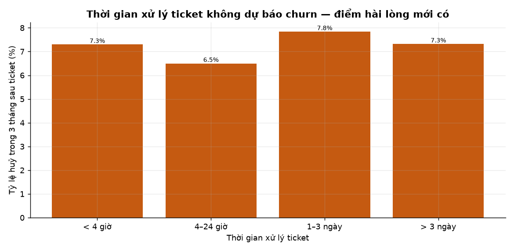

### Cách làm SAI (và tại sao nó cho kết quả ngược)

Cách trực quan là đếm số ticket mỗi tài khoản rồi so tỷ lệ huỷ. Kết quả:

| Số ticket | Tài khoản | Tỷ lệ huỷ |
|---|---:|---:|
| 0 | — | **52,75%** |
| 1–2 | — | 38,46% |
| 3–5 | — | 23,53% |
| 6+ | — | 13,33% |

Nhìn qua sẽ kết luận "mở nhiều ticket thì ít huỷ" — vô lý. Nguyên nhân: **tài khoản rời sớm không có thời gian mở ticket**. Nhóm "0 ticket" chứa đầy khách vừa đăng ký đã bỏ. Đây là **thiên lệch sống sót** (survival bias).

### Cách làm ĐÚNG

Đơn vị phân tích phải là **ticket**, không phải tài khoản. Mỗi ticket có cùng cửa sổ quan sát 3 tháng, nên so sánh được.

| Thời gian xử lý | Ticket | Huỷ trong 3 tháng sau |
|---|---:|---:|
| < 4 giờ | — | 7,30% |
| 4–24 giờ | — | 6,50% |
| 1–3 ngày | — | 7,84% |
| > 3 ngày | — | 7,32% |

**Không có khác biệt có ý nghĩa.** Tốc độ xử lý ticket không dự báo churn.

Nhưng **điểm hài lòng thì có**:

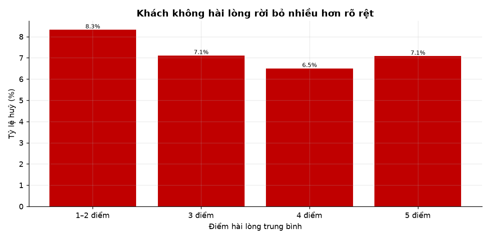

| Điểm hài lòng | Ticket | Huỷ trong 3 tháng sau |
|---|---:|---:|
| 1–2 điểm | 1.052 | **8,32%** |
| 3 điểm | 1.125 | 7,11% |
| 4 điểm | 3.398 | 6,50% |
| 5 điểm | 2.901 | 7,08% |

Khách cho 1–2 điểm có xác suất rời bỏ cao hơn **28%** so với khách cho 4 điểm.

**Kết luận thực tiễn:** đừng tối ưu SLA cho nhanh. Hãy tối ưu **chất lượng lần xử lý đầu tiên** — đo bằng điểm hài lòng, không phải giờ đóng ticket.

---

## 8. Sức khoẻ thanh toán — kênh mất khách đắt nhất

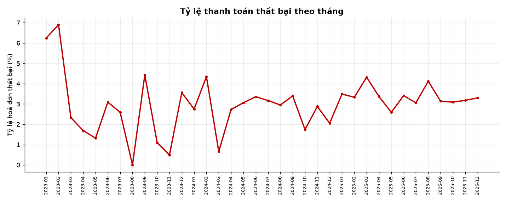

| Phương thức | Hoá đơn | % | Thất bại | Tỷ lệ | Doanh thu gặp rủi ro |
|---|---:|---:|---:|---:|---:|
| Thẻ tín dụng | 9.839 | 61,9% | 303 | 3,08% | $225.307 (3,37%) |
| Chuyển khoản | 3.836 | 24,1% | 110 | 2,87% | $74.470 (2,95%) |
| PayPal | 2.222 | 14,0% | 74 | 3,33% | $52.657 (3,46%) |

Tỷ lệ thất bại khá đồng đều giữa các phương thức (2,9–3,3%) — vấn đề không nằm ở một cổng thanh toán cụ thể.

### Quy trình dunning

| Chỉ số | Giá trị |
|---|---:|
| Hoá đơn thất bại | 487 |
| Tài khoản bị ảnh hưởng | 351 |
| Giá trị hoá đơn thất bại | $352.434 |
| **Thu hồi được sau khi thử lại** | **78,06%** |
| Huỷ ngoài ý muốn | 77 |
| % tổng số vụ huỷ | 18,38% |
| MRR mất do huỷ ngoài ý muốn | **$61.616** |

**Mỗi 5 thẻ hỏng thì 1 khách ra đi vĩnh viễn.** Đây là nhóm dễ cứu nhất trong toàn bộ danh sách churn: khách không hề muốn bỏ, chỉ là thẻ hết hạn.

Với MRR trung bình $800/vụ, việc nâng tỷ lệ thu hồi từ 78% lên 90% sẽ giữ lại khoảng **$34.000 MRR** — tương đương 17 tài khoản Enterprise mới.

---

## 9. Động cơ mở rộng — ghế là nhiên liệu

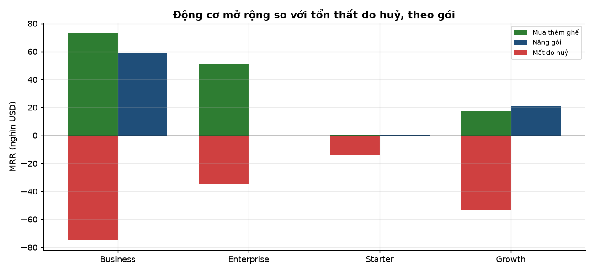

| Gói | Tài khoản | Thêm ghế | Nâng gói | Mất do huỷ | Ròng | Sự kiện mở rộng/100 tài khoản |
|---|---:|---:|---:|---:|---:|---:|
| Business | 474 | +$72.901 | +$59.211 | −$74.518 | **+$56.757** | 105,1 |
| Enterprise | 142 | +$51.018 | $0 | −$34.868 | +$13.605 | 114,1 |
| Growth | 533 | +$17.061 | +$20.672 | −$53.637 | −$17.277 | 51,0 |
| Starter | 248 | +$615 | +$530 | −$14.158 | −$13.181 | 11,3 |

Business là gói duy nhất mà **tổng mở rộng vượt tổng mất đi** với biên rộng. Enterprise có tỷ lệ sự kiện mở rộng cao nhất nhưng quy mô nhỏ.

### 9.1 Tỷ lệ lấp ghế — tín hiệu hai chiều

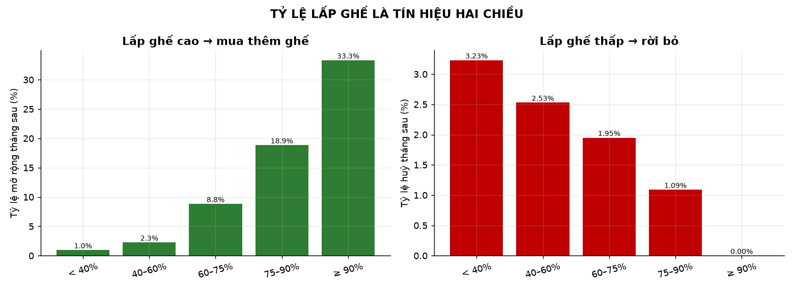

| Tỷ lệ lấp ghế | Số quan sát | Mở rộng tháng sau | Huỷ tháng sau |
|---|---:|---:|---:|
| < 40% | 1.145 | 0,96% | **3,23%** |
| 40–60% | 7.085 | 2,26% | 2,53% |
| 60–75% | 6.614 | 8,83% | 1,95% |
| 75–90% | 1.008 | **18,85%** | 1,09% |
| ≥ 90% | 45 | **33,33%** | 0,00% |

Một chỉ số, hai cách đọc:

- **Lấp ghế cao (≥ 75%)** → khách sắp cần thêm ghế. Đây là **danh sách gọi điện của đội sales**, không phải đội CS.
- **Lấp ghế thấp (< 40%)** → khách đang trả tiền cho chỗ ngồi không dùng. Xác suất huỷ gấp 3 lần nhóm trên.

Quy tắc vận hành rút ra: mỗi tài khoản nên có **một trong hai** hành động được lên lịch — upsell hoặc can thiệp giữ chân. Không có tài khoản nào đứng yên.

---

## Khuyến nghị

Xếp theo tỷ lệ (tác động ước tính) / (công sức triển khai).

### Ưu tiên 1 — Cứu khách bị huỷ oan (tác động ~$34.000 MRR, công sức thấp)

Nâng tỷ lệ thu hồi dunning từ 78% lên 90%:
- Tự động hoá chuỗi nhắc trước ngày hết hạn thẻ 14 ngày
- Thử lại 3 lần trong 10 ngày thay vì 1 lần
- Chuyển sang chuyển khoản tự động cho hoá đơn trên $500
- Cảnh báo cho CS khi một tài khoản có ≥ 2 hoá đơn thất bại

### Ưu tiên 2 — Can thiệp vào 3 tháng đầu (tác động: giảm churn 3,97% → 2,54%)

- Gán CSM riêng cho mọi tài khoản Business/Enterprise trong 90 ngày đầu
- Đo "thời gian tới giá trị đầu tiên" (TTFV) và đặt mục tiêu < 7 ngày
- Tự động cảnh báo khi tài khoản mới có < 5 ngày hoạt động trong tháng đầu

### Ưu tiên 3 — Đội sales gọi theo tỷ lệ lấp ghế (tác động: tăng expansion)

- Danh sách upsell: lấp ghế ≥ 75% + đang dùng ≥ 18 ngày/tháng
- Danh sách can thiệp: lấp ghế < 40% + có hoá đơn thất bại gần đây
- Hiện thực hoá bằng `mart_account_risk` — chạy lại hàng tháng

### Ưu tiên 4 — Xem lại gói Starter

Starter: 248 tài khoản, 43,95% churn, đóng góp 2,7% MRR, ròng −$14.912. Ba lựa chọn:
- Bỏ gói, chuyển sang dùng thử 14 ngày rồi bắt buộc lên Growth
- Giữ nhưng tự động hoá 100% (không CSM, chỉ self-serve)
- Tăng giá để lọc khách — chấp nhận mất số lượng, giữ chất lượng

### Ưu tiên 5 — Dịch ngân sách marketing khỏi paid search

Paid search: 255 tài khoản, churn 35,3%. Referral: 192 tài khoản, churn 22,9%. Nếu CAC của paid search cao gấp đôi referral, LTV/CAC của kênh này có thể đang dưới 1. Cần đo CAC theo kênh trước khi cắt, nhưng đây là nghi phạm số một.

---

## Hạn chế

Cần nêu rõ để không ai đọc báo cáo này như bằng chứng về một công ty thật.

1. **Dữ liệu là mô phỏng.** Không có bộ dữ liệu SaaS công khai nào chứa đủ chuỗi sự kiện gốc để tính MRR/NRR từ đầu. `generate_data.py` sinh dữ liệu theo tham số hiệu chỉnh về chuẩn ngành, nhưng **quan hệ nhân quả trong dữ liệu là do người viết đặt vào**, không phải được phát hiện ra. Ví dụ: việc "điểm hài lòng thấp làm tăng churn" được cài trong code, nên kết quả ở mục 7 là kiểm tra xem phép phân tích có phát hiện lại được tín hiệu đã cài hay không — không phải một phát hiện mới về thế giới thật.

2. **Cỡ mẫu cohort nhỏ.** 15–60 tài khoản/lứa. Chênh lệch 1 khách làm thay đổi 2–7 điểm phần trăm. Đường NRR theo cohort dao động 74%–136% gần như hoàn toàn do nhiễu.

3. **Nhóm Enterprise theo quy mô công ty chỉ có 12 tài khoản.** Tỷ lệ 8,33% là 1/12 — không đủ mẫu.

4. **Không có dữ liệu chi phí.** Không tính được CAC, LTV, payback period, gross margin. Các khuyến nghị về kênh thu hút (mục 4.3) chỉ dựa trên retention, chưa cân nhắc chi phí.

5. **NRR tính theo phương pháp cohort gộp**, không phải NRR của toàn bộ tệp khách tại một thời điểm. Hai cách tính cho kết quả hơi khác nhau; cách dùng ở đây (gộp các cohort đã đủ 12 tháng) tránh được việc trộn khách mới vào mẫu.

6. **Churn được ghi nhận ở tháng cuối còn hoạt động**, không phải tháng đầu tiên vắng mặt. Quy ước này ảnh hưởng ±1 tháng tới mọi chỉ số cohort.

---

## Phụ lục — Bản đồ bảng kết quả

| File CSV | Nội dung | Dùng cho |
|---|---|---|
| `mart_mrr_monthly.csv` | Cầu nối MRR 36 tháng | Báo cáo tài chính tháng |
| `mart_growth_decomposition.csv` | Cơ cấu tăng trưởng toàn kỳ | Thuyết trình hội đồng |
| `mart_cohort_retention.csv` | Ma trận giữ chân khách | Đánh giá onboarding |
| `mart_cohort_revenue.csv` | Ma trận giữ chân doanh thu | Đánh giá upsell |
| `mart_nrr_by_cohort.csv` | NRR/GRR từng cohort | Phân tích xu hướng |
| `mart_retention_summary.csv` | Tổng hợp NRR/GRR | KPI điều hành |
| `mart_churn_by_segment.csv` | Churn theo 5 chiều | Tìm phân khúc rủi ro |
| `mart_churn_by_tenure.csv` | Churn theo thâm niên | Thiết kế onboarding |
| `mart_churn_reasons.csv` | Lý do huỷ | Ưu tiên cải tiến sản phẩm |
| `mart_plan_mix_monthly.csv` | MRR theo gói theo tháng | Theo dõi cơ cấu |
| `mart_plan_performance.csv` | Hiệu quả từng gói | Quyết định giá/gói |
| `mart_usage_vs_churn.csv` | Sử dụng và churn | Xây tín hiệu cảnh báo |
| `mart_account_risk.csv` | **Bảng rủi ro từng tài khoản** | **Vận hành CS hàng ngày** |
| `mart_risk_summary.csv` | Tổng hợp theo mức rủi ro | Báo cáo điều hành |
| `mart_support_impact.csv` | Thời gian xử lý ticket | Đánh giá SLA |
| `mart_satisfaction_band.csv` | Điểm hài lòng và churn | Đánh giá chất lượng hỗ trợ |
| `mart_support_trend.csv` | Khối lượng ticket theo tháng | Dự báo nguồn lực |
| `mart_payment_health.csv` | Sức khoẻ theo phương thức | Chọn cổng thanh toán |
| `mart_dunning.csv` | Hiệu quả thu hồi | Tối ưu quy trình billing |
| `mart_billing_trend.csv` | Tỷ lệ thất bại theo tháng | Giám sát vận hành |
| `mart_expansion_by_tier.csv` | Mở rộng theo gói | Chiến lược upsell |
| `mart_seat_growth.csv` | Tăng trưởng số ghế | Dự báo doanh thu |
| `mart_seat_utilization_bands.csv` | Lấp ghế và hành vi | Xây playbook sales/CS |
| `mart_data_quality.csv` | 45 quy tắc kiểm tra | Đảm bảo chất lượng |
